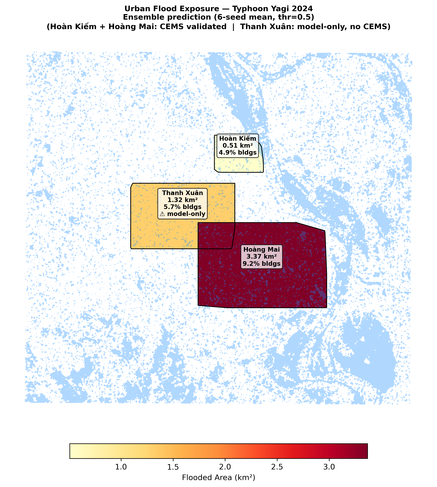
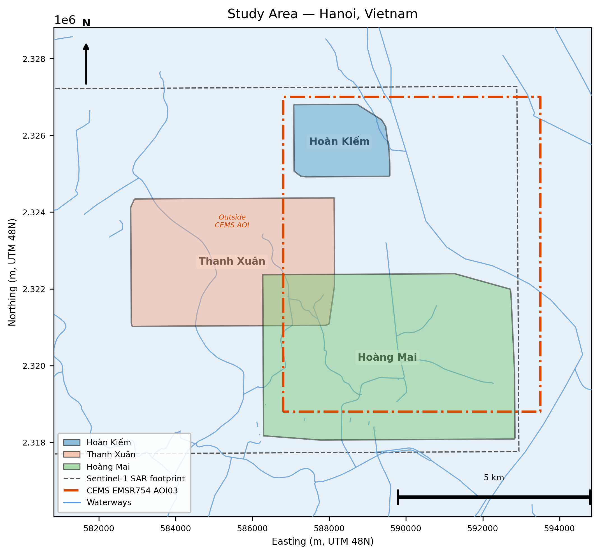
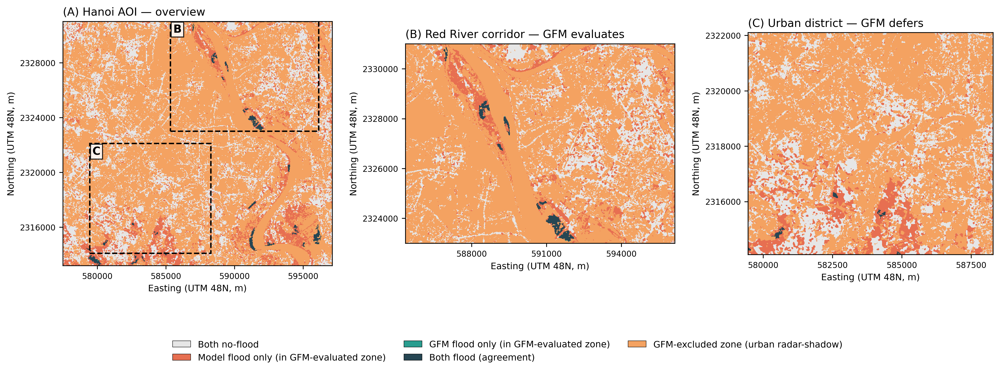

# SAR Flood Mapping in Hanoi

[](https://doi.org/10.1111/tgis.70342)
[](LICENSE)
[](https://www.python.org/)

A reproducible pipeline for multi-temporal Sentinel-1 SAR flood segmentation over Hanoi, Vietnam, with external validation against two methodologically independent operational reference products and OpenStreetMap-based infrastructure exposure assessment.

This repository accompanies the *Transactions in GIS* paper **"Multi-Reference External Validation of Synthetic Aperture Radar Flood Mapping in Hanoi with Volunteered Geographic Information–Based Infrastructure Exposure Assessment"** (Holden, 2026, [DOI: 10.1111/tgis.70342](https://doi.org/10.1111/tgis.70342)). It contains the complete pipeline: data acquisition, SAR preprocessing, deep-learning segmentation, ensemble uncertainty quantification, and downstream exposure analysis.

> **Scope of this repository.** Source code, configuration, and dataset descriptors only. Raw Sentinel-1 scenes (~600 MB), derived stacks (~47 GB), trained checkpoints (~1 GB), and result artefacts are not included — they are fully reproducible from the scripts using the public data sources documented below.



---

## Table of contents

- [Highlights](#highlights)
- [Repository layout](#repository-layout)
- [Hardware and runtime](#hardware-and-runtime)
- [Installation](#installation)
- [Configuration and credentials](#configuration-and-credentials)
- [Data acquisition](#data-acquisition)
- [Running the pipeline](#running-the-pipeline)
- [Reproducing the headline results](#reproducing-the-headline-results)
- [Validation against operational products](#validation-against-operational-products)
- [Limitations and scope](#limitations-and-scope)
- [Citation](#citation)
- [License](#license)

---

## Highlights

- **Two flood events.** Typhoon Yagi (September 2024) and Typhoon Matmo (October 2025) over an urban AOI covering three Hanoi districts (Hoàn Kiếm, Thanh Xuân, Hoàng Mai).
- **Multi-reference external validation.** The model is benchmarked against the Copernicus EMS EMSR754 manual delineation and against the JRC Global Flood Monitoring (GFM) Sentinel-1 product. Same-date recall against GFM is **0.996**; recall against the CEMS EMSR754 delineation is **0.882 ± 0.016** (six-seed ensemble).
- **Two architectures, six seeds each.** U-Net and Attention U-Net trained independently from seed 0 to 5; the 12-seed extension supports the label-noise sensitivity and hydro-loss null-result analyses.
- **Honest reporting.** Three robustness probes (label-noise sensitivity, hydrological-consistency loss regularisation, attention-gate architectural comparison) returned null or sub-threshold results and are reported as such; see Tables S1 and S2 in the Supporting Information.
- **Reproducible end-to-end.** From raw Sentinel-1 zips to district-level exposure CSVs, with deterministic seeds, fixed thresholds, and versioned configuration.

---

## Repository layout

```
configs/        Master YAML config (copy config.example.yaml → config.yaml)
metadata/       Source-dataset descriptors (DEM, ERA5, OSM, S1 search results)
models/         U-Net and Attention U-Net architectures
losses/         BCE + Dice and hydrological-consistency losses
training/       Dataset, trainer, metrics
inference/      Full-scene prediction and exposure analysis
scripts/
  phase_1/      Data acquisition (Sentinel-1, DEM, ERA5, OSM)
  phase_2/      SAR preprocessing chain (orbit → calibration → speckle → terrain
                correction → clip → stack → normalize → QC; uses ESA SNAP gpt)
  phase_3/      Modelling (mask generation, patches, training, evaluation,
                ablations, cross-event transfer, full-scene inference,
                exposure analysis)
  phase_4/      Validation (label-noise sensitivity, uncertainty
                quantification, statistical significance testing)
  hydro/        Hydrological-consistency loss training harness
docs/img/       README assets
```

---

## Hardware and runtime

The published results were produced on a single workstation:

- **GPU:** NVIDIA RTX 4070 (12 GB VRAM)
- **Training:** mixed precision (fp16), batch size 8, patch size 256, ≈100 epochs with cosine schedule and early stopping
- **Per-seed wall-clock:** approximately 2–3 hours for one Attention U-Net seed on the full Yagi + Matmo training set
- **Full six-seed ensemble:** ≈12–18 hours of GPU time
- **Phase 2 (SAR preprocessing):** several hours of CPU + disk time for both events; dominated by ESA SNAP graph execution

A smaller GPU (≥6 GB VRAM) will work with a reduced batch size; an A100 or H100 cuts training time by a factor of 3–4 but is not required.

---

## Installation

### With conda (recommended)

```bash
conda env create -f environment.yaml
conda activate flood_sar
```

### With pip

```bash
python -m venv .venv
source .venv/bin/activate     # Windows: .venv\Scripts\activate
pip install -r requirements.txt
```

You will additionally need:

- **GDAL** ≥ 3.4 with Python bindings (provided by the conda env; for pip installs use OS-level GDAL plus `pip install gdal==<system-version>`)
- **ESA SNAP** ≥ 10.0 with the `gpt` command on `PATH`, for Phase 2 only ([download](https://step.esa.int))

---

## Configuration and credentials

Most scripts auto-detect the repository root from their own location, so no path editing is needed. The Phase 3/4 training scripts read the master config:

```bash
cp configs/config.example.yaml configs/config.yaml
# Optionally edit configs/config.yaml — replace <PROJECT_ROOT>
# with your repo path if you want explicit absolute paths.
```

Credentials are supplied via environment variables:

| Variable | Used by | Required? |
|---|---|---|
| `CDSE_USERNAME`, `CDSE_PASSWORD` | `scripts/phase_1/copernicus.py` (Sentinel-1 download) | Yes for Phase 1 |
| `OPENTOPO_API_KEY` | `scripts/phase_1/dem_download.py` | No — falls back to a public demo key sufficient for this AOI |
| `SAR_ROOT` | `scripts/phase_2/phase2_config.py` | No — defaults to `data_raw/sentinel1/` |
| `SNAP_GPT` | `scripts/phase_2/phase2_config.py` | No — assumes `gpt` is on `PATH` |

For ERA5 precipitation, place a `.cdsapirc` file in your home directory with your Copernicus CDS API key — instructions at [cds.climate.copernicus.eu](https://cds.climate.copernicus.eu).

---

## Data acquisition

All raw data is downloaded by Phase 1 scripts. Accounts needed (all free):

| Dataset | Source | Coverage |
|---|---|---|
| Sentinel-1 SAR GRD | Copernicus Data Space Ecosystem | 4 scenes (2 events × pre/post) |
| SRTM 30 m DEM | OpenTopography | One tile over the AOI |
| ERA5 hourly precipitation | Copernicus Climate Data Store | September 2024 + October 2025 |
| OpenStreetMap infrastructure | Overpass API via `osmnx` | Buildings, roads, hospitals, schools |
| CEMS EMSR754 reference | Copernicus Emergency Management | Manual delineation, Yagi 2024 |
| JRC GFM v3 | EODC STAC catalogue | Operational SAR flood product |

The `metadata/` folder records the exact scene IDs, AOIs, and date ranges used in the paper.

---

## Running the pipeline

```bash
# Phase 1 — acquire raw data
python scripts/phase_1/copernicus.py     # Sentinel-1 (≈600 MB)
python scripts/phase_1/dem_download.py
python scripts/phase_1/era5_download.py
python scripts/phase_1/osm_download.py

# Phase 2 — SNAP preprocessing chain
python scripts/phase_2/make_aoi_from_bbox.py
python scripts/phase_2/run_phase2.py      # orbit → noise → calibrate → speckle → terrain → clip → stack → normalize → QC

# Phase 3 — modelling
python scripts/phase_3/01_build_stacks.py
python scripts/phase_3/02_create_masks.py
python scripts/phase_3/03_generate_patches.py
python scripts/phase_3/04_train_unet.py            --seed 0
python scripts/phase_3/05_train_attention_unet.py  --seed 0
# ... repeat seeds 0–5 for the published ensemble
python scripts/phase_3/06_ablation.py
python scripts/phase_3/07_cross_event.py
python scripts/phase_3/08_inference_fullscene.py
python scripts/phase_3/09_exposure_analysis.py
python scripts/phase_3/10_visualize.py

# Phase 4 — validation
python scripts/phase_4/01_label_noise_sensitivity.py
python scripts/phase_4/03_uncertainty_quantification.py
python scripts/phase_4/06_statistical_significance.py
```

All phase-3/4 scripts read seeds and run names from `configs/config.yaml`. Outputs land under `outputs/` and `data_processed/` (both gitignored).

---

## Reproducing the headline results

The published metrics are produced by a six-seed Attention U-Net trained on the combined Yagi + Matmo training rows:

```bash
for seed in 0 1 2 3 4 5; do
  python scripts/phase_3/05_train_attention_unet.py --seed $seed
done
python scripts/phase_3/aggregate_results.py
python scripts/phase_4/03_uncertainty_quantification.py
```

Expected test-row IoU is in the range 0.61–0.64 across seeds; full-scene CEMS recall converges around 0.88 ± 0.02 with sufficient seeds.



---

## Validation against operational products

Same-date agreement against the JRC Global Flood Monitoring product is shown below (recall 0.996, with the structural precision gap discussed in §5 of the paper). Pixels are categorised as model-only, GFM-only, both, or GFM-excluded.



---

## Limitations and scope

- This pipeline is a **research reference implementation**, not an operational deployment. Threshold and morphological parameters are tuned for the published AOI and events.
- Pseudo-label generation uses VV-change thresholds calibrated for Hanoi typhoon-flood conditions. Transfer to other deltaic geographies requires re-calibration.
- The model is bounded by recall against operational references; the precision gap is acknowledged as a structural property of pseudo-label-trained SAR flood models and not defended.
- Cross-event transfer between Yagi 2024 and Matmo 2025 shows ΔIoU = −0.347 in one direction and +0.057 in the other; single-event-trained operational deployment is not advised.
- OpenStreetMap building completeness drives the exposure analysis. The three Hanoi study districts are well-mapped; coarser coverage elsewhere will degrade the downstream exposure figures.

---

## Citation

If you use this code, please cite the paper:

```bibtex
@article{Holden2026SARFloodHanoi,
  title   = {Multi-Reference External Validation of Synthetic Aperture Radar
             Flood Mapping in Hanoi with Volunteered Geographic
             Information--Based Infrastructure Exposure Assessment},
  author  = {Holden, Nick},
  journal = {Transactions in GIS},
  year    = {2026},
  doi     = {10.1111/tgis.70342}
}
```

A `CITATION.cff` file is provided for GitHub's "Cite this repository" button.

---

## License

[MIT License](LICENSE). The Sentinel-1 imagery used for development is licensed under the Copernicus open licence; OpenStreetMap data is © OpenStreetMap contributors under the Open Database Licence; CEMS EMSR754 data is provided under the Copernicus EMS terms of use.
